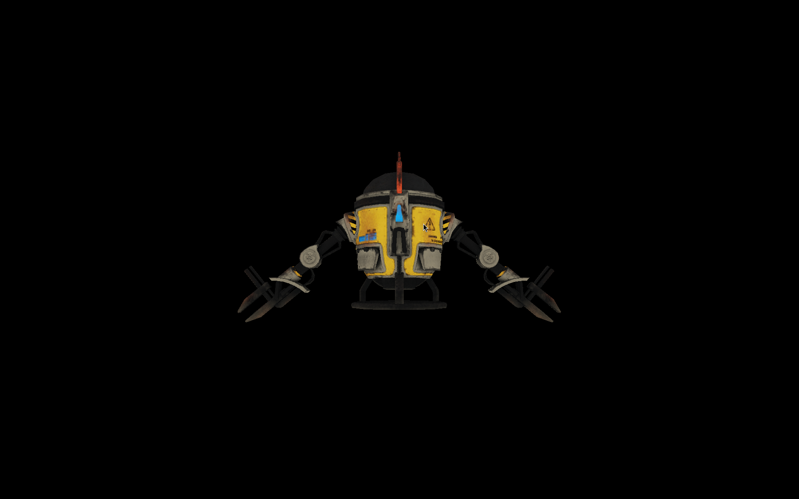

# Softy

A software 3D renderer made while taking https://pikuma.com/courses/learn-3d-computer-graphics-programming
This is architecturally horrible - `main.jai` does many things that is should not. This is a learning/academic project, so architecture is not the biggest concern.



- [Building](#building)
- [Lectur notes](#lecture-notes)
- [Capabilities](#capabilities)
- [Controls](#controls)

## Building

```bash
jai ./build.jai - --very-optimized +Autorun
```

## Lecture notes

The `notes` directory contains Typst lecture notes. They can be compiled to `.pdf` files:
```bash
typst compile name_of_note.typ
```

## Capabilities

- Rendering meshes loaded from Wavefront `.obj` files
- Flat-shading based on the sun-ray direction for colored meshes
- Textured rendering using barycentric coordinates
- Camera
- Full matrix-based transformations (model, view, projection transformations)
- Z-buffering

## Controls

- Escape - quit

- 1 - Render only wireframe end vertex points
- 2 - Render only wireframe
- 3 - Render only flat-shaded faces
- 4 - Render only flat-shaded faces and wireframe
- 5 - Render only textured faces
- 6 - Render only textured faces and wireframe

- c - Enable backface culling
- d - Disable backface culling

- w - Move camera forward
- a - Rotate camera left
- r - Move camera backwards (yes, this is for colemak)
- s - Rotate camera right

- Arrow Up   - move camera up
- Arrow Down - move camera up
